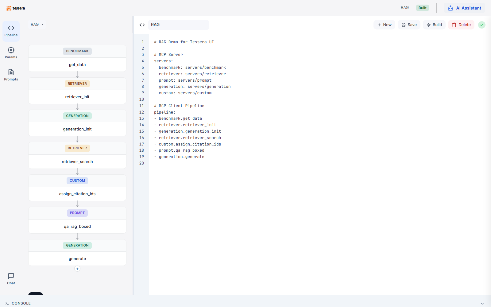
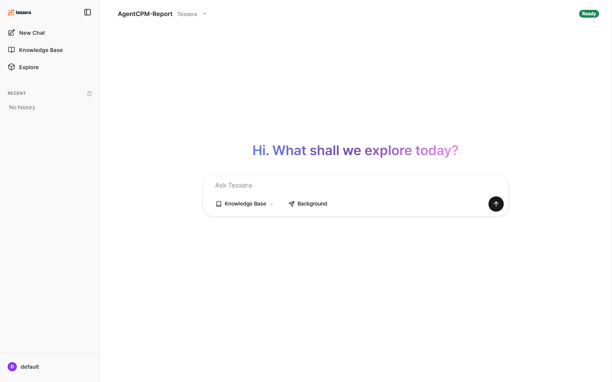

<p align="center">
  <picture>
    <source media="(prefers-color-scheme: dark)" srcset="./docs/tessera_dark.svg">
    <source media="(prefers-color-scheme: light)" srcset="./docs/tessera.svg">
    
  </picture>
</p>

<h3 align="center">RAG pipelines you can see, assembled from MCP servers</h3>

<p align="center">
  <a href="https://github.com/Dxlxz/tessera/actions/workflows/ci-smoke.yml"></a>
  
  
  
  
</p>

---

**Tessera** turns the parts of a RAG system — retrieval, reranking, prompting, generation, routing, memory,
evaluation — into independent **MCP servers**, then composes them into a pipeline you can build on a canvas or
write as YAML. The canvas and the file are the same pipeline: edit one, the other follows.

Most RAG frameworks hide the pipeline inside Python call stacks. Tessera keeps every step as a service with a typed
interface, so you can swap a retriever, pin a prompt, replay a trace, or score a run without rewriting the app.

<p align="center">
  
</p>

<p align="center">
  
</p>

## Why this shape

- **Components are services, not imports.** Each stage speaks MCP, so the same pipeline runs in-process, over
  HTTP, or with a stage you wrote in another language. Nothing is reachable except through its declared tools.
- **The pipeline is data.** A YAML file describes servers, steps, inputs and outputs, including `loop` and
  `branch` with a `router`. That file is the artefact you review, diff, version and ship.
- **Evaluation is a stage, not a spreadsheet.** Scoring is an MCP server like any other, so a pipeline can grade
  itself, and retrieval changes get measured instead of argued about.
- **Two execution modes, one pipeline.** `--no-mcp` runs everything locally in one process (fast iteration, no
  subprocesses); the default mode starts the servers as MCP processes. Same YAML, same outputs.

## What you get

| | |
|---|---|
| **Pipeline IDE** | Canvas ↔ code synchronisation, per-node parameter and prompt editing, run history, case study view of every intermediate output |
| **Knowledge bases** | Ingestion from text, PDF, DOCX and images (MinerU), chunking, Milvus / BM25 / hybrid indexes, visibility control |
| **Retrieval** | Dense, sparse and hybrid search, reranking, web search backends, multi-hop pipelines (IRCoT, Iter-RetGen) |
| **Generation** | vLLM, OpenAI-compatible endpoints, LiteLLM, streaming, structured output |
| **Evaluation** | TREC-style retrieval metrics, answer metrics, paired p-value comparison between two runs |
| **Serving** | One FastAPI app (`tessera show ui`), Docker images with the frontend pre-built |
| **Extensibility** | Drop a folder in `servers/`, register tools, reference it from YAML — no core changes |

## Quick start

Requires Python 3.11 or 3.12 and [uv](https://github.com/astral-sh/uv).

```shell
git clone https://github.com/Dxlxz/tessera.git
cd tessera

uv sync --python 3.12              # local execution mode
uv sync --extra mcp                # + MCP execution (default mode)
uv sync --all-extras               # + retriever, generation, corpus, evaluation backends
```

Smoke test — a one-node pipeline that proves the engine is wired up:

```shell
uv run tessera build examples/experiments/sayhello.yaml --no-mcp
uv run tessera run   examples/experiments/sayhello.yaml --no-mcp
```

Expected output: `Hello, Tessera v3!`

Then open the UI:

```shell
uv run tessera show ui --no-mcp     # http://localhost:5050
```

### Docker

```shell
docker build -f Dockerfile.base-cpu -t tessera:cpu .
docker run --rm -it -p 5050:5050 tessera:cpu
```

The image ships the built frontend, so `http://localhost:5050` works immediately.

## A pipeline

```yaml
# servers are directories under servers/, each one an MCP server
servers:
  retriever: servers/retriever
  reranker:  servers/reranker
  generation: servers/generation

# the client executes this, in order
pipeline:
  - retriever.retriever_init
  - generation.generation_init
  - retriever.retriever_search:
      input:
        query_list: query_ls
      output:
        passages_ls: retrieved_passages_ls
  - reranker.rerank:
      input:
        passages_ls: retrieved_passages_ls
  - generation.generate:
      output:
        ans_ls: answer_ls
```

`loop`, `branch` with `router` steps, and per-step `input`/`output` binding cover the control flow real pipelines
need — multi-hop retrieval, self-critique, tool loops. See `examples/demos/` for full systems, including a
140-step deep-research pipeline.

## Layout

```
servers/        MCP servers: retriever, reranker, generation, router, memory, prompt, evaluation, corpus, benchmark
src/tessera/    client, dispatcher, configuration, Python API (ToolCall / PipelineCall)
ui/             FastAPI backend, React + Vite frontend (canvas, knowledge base, chat)
examples/       runnable pipelines: retrieval, evaluation, multimodal, deep research
tests/          engine, packaging and execution-parity tests
```

## Evaluation

Two runs of the same dataset, scored and compared:

```shell
uv run tessera run examples/experiments/eval_trec.yaml
uv run tessera run examples/experiments/eval_trec_pvalue.yaml
```

Because scoring is a server, the metrics live next to the data, and retrieval changes (chunk size, reranker,
hybrid weights) can be gated on a measured delta instead of a hunch.

## Roadmap

- [ ] Qdrant backend alongside Milvus, with hybrid search in the reference pipeline
- [ ] Tool-approval gates and an audit record for pipelines that call external tools
- [ ] Regression gate in CI: block a retrieval change that lowers the evaluation score
- [ ] Trace viewer for a single run, keyed by step, with token and latency cost per node

## See also

**[Lintel](https://github.com/Dxlxz/lintel)** — guardrails, policy and decision records for the same pipelines:
validate what goes in, repair what comes out, record every decision.

**[Quorum](https://github.com/Dxlxz/quorum)** — a fund desk of LLM agents on top of the same ideas: risk limits,
an approval gate and a hash-chained decision ledger.

## License and lineage

Apache-2.0 — see [LICENSE.txt](./LICENSE.txt) and [NOTICE](./NOTICE).

Tessera is developed from the UltraRAG codebase (Apache-2.0, THUNLP · NEUIR · OpenBMB · AI9stars), with the
package, CLI, branding and product surface rebuilt around the MCP-native design. Upstream copyright is retained
in the license and notice files.
